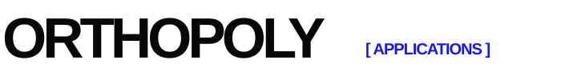

# Orthopoly Applications



A small Python library based on the themes in *Orthogonal Polynomials, Orbit Functions, and Their Applications* (Victoria Portnaya, 2025). It provides trainable polynomial regression, Chebyshev graph node classification, and Laguerre time-series forecasting, alongside classical basis and orbit-function utilities.

Read the [full documentation](docs/index.md) for installation, training workflows, API details, and mathematical conventions. The [use cases](docs/use-cases.md) map common data problems to the library methods and include reproducible example outputs. [Real-data benchmarks](docs/real-data-benchmarks.md) compare the three trainable models with simple baselines, including results where a baseline wins.

## Install

From this directory:

```bash
python3 -m pip install -e .
```

Requires Python 3.10+, NumPy and SciPy. The package has no PyTorch dependency.

## Quick start

```python
import numpy as np
from orthopoly_applications import (
    PolynomialFamily, project_function, normalized_laplacian,
    chebyshev_graph_filter, LaguerreExpansion, WeylOrbit, cartan_matrix,
)

# Weighted Jacobi approximation of f(x) = x**2 on [-1, 1].
family = PolynomialFamily("jacobi", alpha=0.5, beta=0.5)
coefficients = project_function(lambda x: x**2, family, degree=2)
approximation = family.evaluate_series(coefficients, 0.3)

# A two-node graph: degree-0 and degree-1 Chebyshev spectral filter.
adjacency = np.array([[0., 1.], [1., 0.]])
laplacian = normalized_laplacian(adjacency)
filtered = chebyshev_graph_filter(laplacian, np.array([1., 0.]), [1., -0.5], lambda_max=2.)

# Compress a sampled causal signal into four Laguerre coefficients.
times = np.linspace(0, 8, 200)
signal = np.exp(-times) * (1 + times)
memory = LaguerreExpansion.fit(times, signal, order=4, rate=1.)
later = memory.reconstruct(np.array([1., 2., 3.]))

# Weyl-orbit analogue of a cosine basis; A1 weight 1 has orbit {+1,-1}.
orbit = WeylOrbit(cartan_matrix("A1"), (1,))
assert np.allclose(orbit.evaluate(np.array([[0.25]]), "C"), 0)
```

Run the full example with `python3 examples/quickstart.py` after installation.

## Train models for applications

```python
import numpy as np
from orthopoly_applications import (
    PolynomialFamily, PolynomialRegressor,
    ChebyshevGraphClassifier, LaguerreForecaster,
)

# Fit a regression model on labeled (x, y) pairs.
x = np.linspace(-2, 3, 50)
y = 1 + 2*x - 0.5*x*x
regressor = PolynomialRegressor(PolynomialFamily("chebyshev"), degree=2).fit(x, y)
predicted_y = regressor.predict(np.array([0.2, 0.5]))

# Train a graph node classifier with labels at selected nodes only.
adjacency = np.array([
    [0, 1, 1, 0, 0, 0], [1, 0, 1, 0, 0, 0], [1, 1, 0, 1, 0, 0],
    [0, 0, 1, 0, 1, 1], [0, 0, 0, 1, 0, 1], [0, 0, 0, 1, 1, 0],
], dtype=float)
features = np.array([-1.2, -0.8, -1.0, 1.1, 0.9, 1.2])
labels = np.array([0, 0, 0, 1, 1, 1])
train_mask = np.array([True, True, False, True, True, False])
classifier = ChebyshevGraphClassifier(order=2, ridge=1e-3)
classifier.fit(adjacency, features, labels, train_mask)
probabilities = classifier.predict_proba(adjacency, features)
predicted_labels = classifier.predict(adjacency, features)

# Fit a causal forecaster. No target at index >= 200 enters training.
signal = np.sin(0.2 * np.arange(240))
forecaster = LaguerreForecaster(window=20, order=10, rate=0.25, horizon=1)
forecaster.fit(signal, train_end=200)
target_indices, forecasts = forecaster.predict_series(signal)
test_rmse = np.sqrt(np.mean((forecasts[target_indices >= 200]
                             - signal[target_indices[target_indices >= 200]])**2))
```

The complete executable training demo is `python3 examples/train_applications.py`. It creates deterministic sample data and reports held-out metrics for all three models. Replace the sample arrays with your data to train on a real application.

## API conventions and scope

- `PolynomialFamily` uses **standard**, not unit-normalized, Jacobi, physicists' or probabilists' Hermite, first-kind Chebyshev, and Laguerre polynomials. `norm_squared` and Gaussian quadrature use their matching weights. `project_function` computes weighted expansion coefficients by quadrature.
- `chebyshev_graph_filter` evaluates `sum c[k] T_k(2L/lambda_max - I) X` by recurrence. For the normalized Laplacian, `lambda_max=2` is a valid bound. `ChebyshevGraphClassifier` trains weights on these graph features with a softmax cross-entropy objective. It supports transductive node classification; graph structure and unlabeled features are visible at training time.
- `LaguerreExpansion.fit` estimates coefficients for the orthonormal functions `sqrt(2a) exp(-at) L_n(2at)` from a finite sampled interval by least squares. `reconstruct` can evaluate the fitted history at requested delays. It is not a full recurrent or delay-system model.
- `LaguerreForecaster` encodes each history window with the same basis and fits a ridge-regularized forecast readout. `train_end` prevents held-out targets from entering training. For honest evaluation, choose model settings using a validation interval before reporting final test accuracy.
- `PolynomialRegressor` fits polynomial coefficients by least squares (optionally ridge-regularized). Chebyshev and Jacobi inputs are scaled using the training range; inputs outside that range are extrapolations.
- `WeylOrbit` supports A1, A2, B2 and G2, with weights in fundamental-weight coordinates and evaluation points in dual coordinates. `S` uses determinant signs and is zero for a weight on a reflection wall. Orbit sums are complex-valued: for A1, `S_1(x)=2i sin(2πx)` under the stated exponential convention.
- The coursework states several broad orthogonality and symmetry claims whose normalization or domain needs extra care. This library does not encode its continuous/discrete WDFT formulas or a general root-lattice classifier. For example, Jacobi's stated integral is an orthogonality norm, not an orthonormality identity.

## Tests

```bash
python3 -m unittest discover -s tests -v
```

## Real-data comparison

Install `examples/benchmark-requirements.txt`, then run `python3 examples/benchmark_real_data.py`. The script tests BMI-only regression on diabetes measurements, node classification on Zachary's Karate Club network, and one-year-ahead prediction on historical sunspots. See [the evaluation protocol and results](docs/real-data-benchmarks.md); the checked-in `examples/real-data-results.json` contains the full output.
